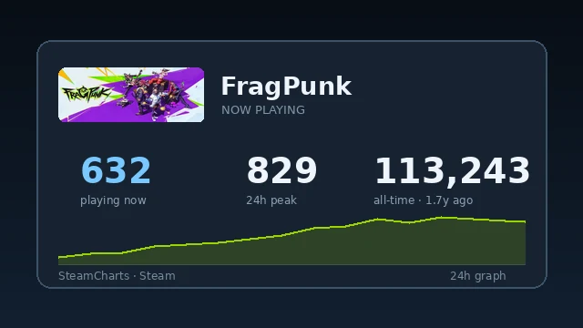

<div align="center">

# LGL SteamDB Stats

**A Noctalia card that shows live Steam player stats for the game you are playing.**

[](steamdb-stats/plugin.toml)
[](steamdb-stats/plugin.toml)
[](LICENSE)

</div>

---

## Overview

LGL SteamDB Stats detects the game Steam is currently running, then renders a
compact SteamDB-style summary on the desktop:

- current players
- 24-hour peak
- all-time peak and its age
- a 24-hour player graph

The card uses the same inner surface, card width, padding and `ui.graph`
metrics as [LGL Modern SysMonitor Plus](../lgl-modern-sysmonitor-plus/), so the
two can sit in the same desktop column and line up.

<p align="center">
  
</p>

| Field | Value |
| --- | --- |
| Plugin ID | `linuxgamerlife/steamdb-stats` |
| Version | `0.1.0` |
| Entries | Service `poller`, desktop widget `card` |
| Plugin API | 24 |
| License | MIT |

## Important: desktop widget, not an in-game overlay

This is a **Noctalia desktop widget**. It sits on the desktop with your other
widgets; it does not draw above a fullscreen game.

Noctalia KWE 5.3.0 exposes plugin API 30. A click-through overlay above every
window needs plugin API 36 (`[[layer]]` with `click_through = true`), which is
not available in this shell version. See
[docs/noctalia.md](docs/noctalia.md#overlay-limits) for the details.

## Requirements

- Noctalia v5 or Noctalia KWE v5
- A Steam client that writes its normal `logs/gameprocess_log.txt`
- `curl` for the optional cached cover image
- An internet connection for the player stats

Supported Steam layouts:

- `~/.steam/root`
- `~/.steam/steam`
- `~/.local/share/Steam`
- `~/.steam/debian-installation`
- Flatpak: `~/.var/app/com.valvesoftware.Steam/.local/share/Steam`
- Snap: `~/snap/steam/common/.local/share/Steam`

## Install

Run either the KWE installer or the upstream installer, not both.

```bash
# Noctalia KWE
./apps/lgl-steamdb-stats/install-kwe.sh

# Upstream Noctalia
./apps/lgl-steamdb-stats/install.sh
```

Then open **Settings → Desktop → Toggle Editor** and add **SteamDB Stats**.

Uninstall with:

```bash
./apps/lgl-steamdb-stats/uninstall-kwe.sh
# or
./apps/lgl-steamdb-stats/uninstall.sh
```

The uninstallers remove this plugin's desktop widget instance but leave other
widgets alone.

## How it works

1. The `poller` service tails Steam's own
   `logs/gameprocess_log.txt` and replays `AppID <id> adding PID <pid>` and
   `Remove <id> from running list`.
2. It verifies the tracked process still exists in `/proc` and is not a zombie,
   so a Steam crash cannot leave the card stuck on a game.
3. It reads `steamapps/appmanifest_<appid>.acf` from every Steam library to get
   the game name.
4. It downloads the game's header from Valve's store API and caches it as
   `header_v2_<appid>.jpg`; SteamCharts is the fallback. Each detected game gets
   its own cached image, so the card changes automatically when you switch
   games.
5. It publishes one plain `steam_stats` table. The `card` entry only watches
   that table and renders the UI.

The card also remembers the last good values for a handful of AppIDs, so a
restart or a temporary network failure does not blank it.

## Data source

SteamDB itself does not allow automated clients:

- `steamdb.info/api/GetGraph/...` returns HTTP `410`
- `steamdb.info/app/...` returns HTTP `403` behind Cloudflare

This port therefore uses:

- **SteamCharts** for the current count, 24-hour peak, all-time peak and the
  24-hour chart series
- **Valve's `ISteamUserStats/GetNumberOfCurrentPlayers`** for a more frequent
  live count
- **Valve's store `appdetails` API** for the game header image, with a
  SteamCharts image fallback

The graph and the 24-hour peak come from the same SteamCharts series, so they
agree with each other. All-time history can differ slightly from SteamDB's
independent tracking.

No Steam API key, Steam login or account token is used.

## Settings

### Plugin-level

| Key | Default | Meaning |
| --- | ---: | --- |
| `detect_interval` | 3 s | How often to check Steam's process log |
| `current_refresh` | 60 s | How often to refresh the live count |
| `stats_refresh` | 600 s | How often to refresh the peaks and graph |

### Desktop card

The card settings follow the same grouping as Modern SysMonitor Plus:

- **Sections:** `hide_when_idle`, `show_title`, `show_settings_button`,
  `show_cover`, `show_current`, `show_peak_24h`, `show_peak_all_time`,
  `show_graph`, `show_attribution`
- **Layout:** `title`, `content_width`, `card_gap`, `card_padding`,
  `card_radius`, `card_fill_color`, `card_fill_opacity`, `card_border_color`,
  `card_border_width`
- **Styling:** `accent_color`, `text_color`, `muted_text_color`, `graph_color`
- **Scaling:** `graph_height`, `graph_line_width`, `graph_fill_opacity`,
  `text_scale`
- **Host panel:** `background`, `background_color`, `background_opacity`,
  `background_radius`, `background_padding`

The `show_card_settings`, `show_styling`, `show_scaling` and `show_sections`
toggles hide the long settings lists until you need them; the stored values
stay active.

### Matching the SysMonitor card

To line the two cards up:

| Setting | Value |
| --- | --- |
| `content_width` | `320` (both cards) |
| `card_padding` | `10` |
| `card_radius` | `8` |
| `card_fill_color` | `surface_variant` |
| `card_fill_opacity` | `0.35` |
| `card_border_color` | `outline` |
| `graph_height` | `32` (SysMonitor network default) |
| `graph_line_width` | `1.5` |
| `graph_fill_opacity` | `0.15` |
| `graph_color` | `primary` (or `#9bd400` for SteamDB green) |

Place both widgets in the same desktop column. Noctalia does not have a shared
multi-widget layout container, so alignment is done by matching the dimensions
and snapping the tiles in the editor.

## What is detected

- Steam games launched by the Steam client, native or Proton
- Games installed on any Steam library listed in `libraryfolders.vdf`
- Flatpak and Snap Steam when installed in their standard paths

Not detected or not covered:

- Games launched outside Steam
- Emulators and non-Steam shortcuts with a generated AppID and no manifest
- Games with no SteamCharts page: the card falls back to the live count and
  shows the peaks as `—`
- A true click-through overlay above a fullscreen game (see below)

## Troubleshooting

```bash
# Validate the plugin manifest and entries
noctalia-kwe plugins lint /path/to/lgl-noctalia-widgets/apps/lgl-steamdb-stats

# See the last game-launch lines Steam wrote
tail -n 20 ~/.local/share/Steam/logs/gameprocess_log.txt

# Follow the plugin log
journalctl --user -n 200 --no-pager | grep -iE 'steamdb-stats|plugin'
```

If the card says **Steam not found**, check that Steam is installed in one of
the paths above. If it says **No Steam game running** while a game is open,
check the log tail for the AppID and PID lines; if the process is visible in
`ps`, the detector should find it on the next poll.

If the game appears but the peaks say **—**, SteamCharts may not track that
game. The live count still comes from Valve's endpoint.

## Privacy

The plugin reads local Steam logs and manifests, and sends only the numeric
AppID to SteamCharts and Valve. It does not read your Steam credentials, chat,
friends list, playtime or account profile. The only files it writes are a small
`cache.json` and a cached cover image in the plugin data directory.

## Credits and licences

- Plugin code: MIT, LinuxGamerLife.
- Player data: [SteamCharts](https://steamcharts.com/) and
  [Steam](https://steampowered.com/). This project is not affiliated with
  Valve, SteamDB or SteamCharts.
- The card layout follows the SteamDB reference and the visual language of
  [LGL Modern SysMonitor Plus](../lgl-modern-sysmonitor-plus/).

See [LICENSE](LICENSE) and [REUSE.toml](../../REUSE.toml).
